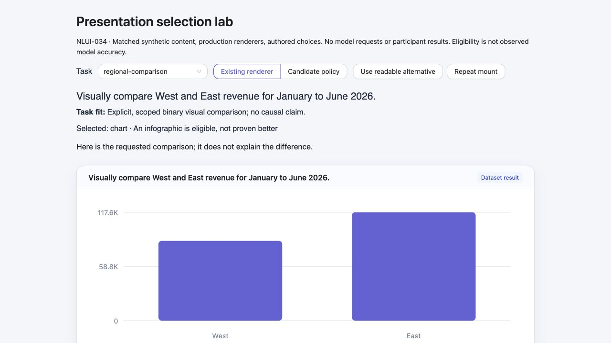
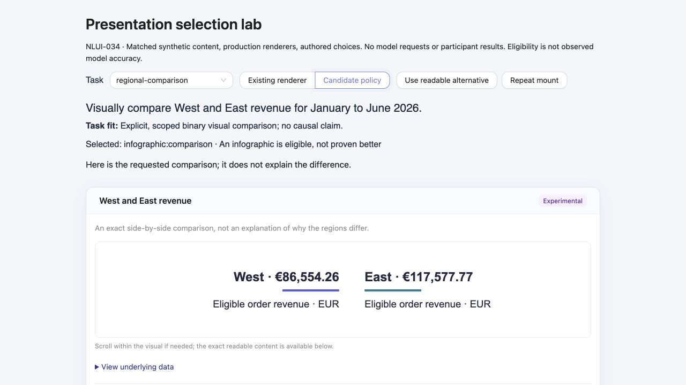
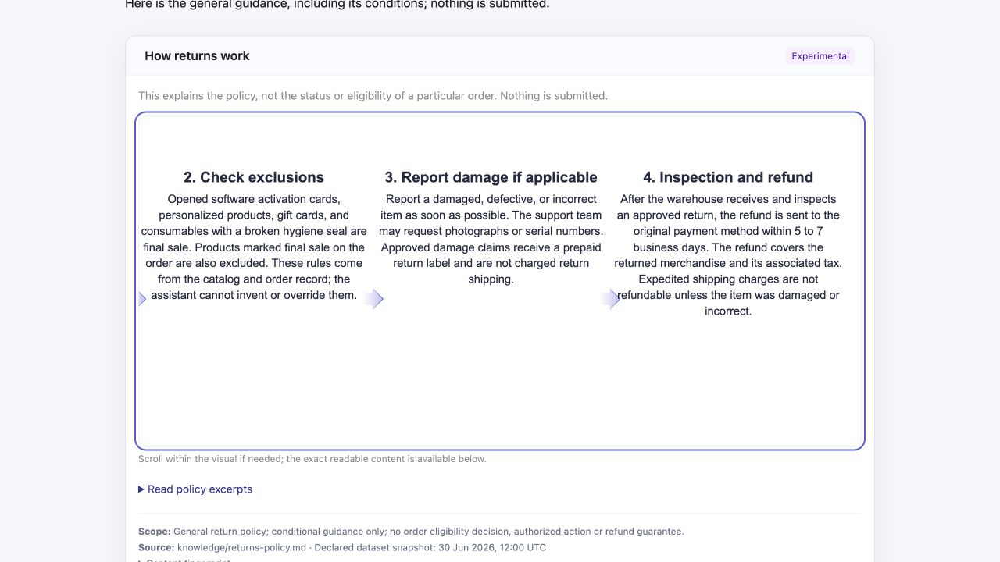

# NLUI-034: matched presentation-selection evaluation

Historical state as of 2026-10-15. The separately approved [2026-10-16 live pilot](2026-10-16-selection-pilot.md) supersedes the pending-live status below; original reference/browser results and their limitations are preserved unchanged.

Date: 2026-10-15. Interim decision: **no promotion**. Controlled prose/scalars/tables/charts/sources remain defaults; AntV Infographic remains an off-by-default, read-only experiment. The deterministic/rendered phase is complete with an inconclusive benefit result. **NLUI-034 remains In progress** until actual model-selection evidence is collected with a newly authorized provider-attempt cap. This is not a live-selection or human-comprehension qualification.

## Frozen protocol and what actually ran

`src/evals/presentation/cases.ts` freezes **presentation-v1**, 16 hand-labelled prompts, reasons, representation eligibility and non-duplicative annotations. Catalog SHA-256: `82ab42df009114cbcc11d759c37bd5a781983a84fe04863b6dae65e27d12a063`. The raw disposable v2 fixture fingerprint is `4058b52984743515bdd8e6404708cdad1b3192d03279b3bc21ba5b239586377c`, unchanged across all twelve persisted tables before/after execution. The source snapshot remains **30 June 2026, 12:00 UTC**. No retained database or provider configuration was reset, replaced or published.

| Task family | Existing renderer | Eligible experimental alternative |
| --- | --- | --- |
| Customer count | Statistic | None |
| Latest customers, empty rows, literal adversarial record | Table | None |
| Monthly revenue, explicitly requested line | Line chart | None |
| Explicit West/East observed revenue comparison | Bar chart | Binary infographic |
| Explicit recorded order history | Dated event table | Sequence infographic |
| General conditional return policy | Full source excerpts | Process infographic |
| Ambiguous, future forecast, unsupported cause, order eligibility, incompatible five-region scope | Clarification/limitation | None |
| Missing order | Informational missing-result state | None |
| Two zero-revenue totals | Exact zero-valued table | None |

Eligibility is the preregistered contract for these specific tasks, **not a universal judgment of all useful layouts**. A valid control remains acceptable in the candidate arm. A hand-authored reference adapter constructs both arms; there is no prompt classifier, simulated LLM, new production router, or assertion that the actual model made these choices.

The oracle reads raw SQLite independently of tool and renderer projections: exact cents-to-EUR totals with effective date/status scope; deterministic customer ordering; observed UTC lifecycle fields without forecasts/refund inference; and independently extracted **complete** policy sections. The three candidate blocks come from the real gated tool. The controlled projections use the same verified content and production `NluiRenderer`, including its real table/date/chart/source components. Independent copies prevent a projection from mutating its oracle. Object-key order is not semantic; row/event order is.

The grader checks renderer eligibility **separately** from block validity, exact rows/values/labels, formats/units, source/scope/snapshot, full conditions, ordering, authored warnings/titles and finite annotation contracts. It does not grade arbitrary language quality. Strict issued block IDs alone do not establish task fit: a regression selects a real issued comparison through the real JSON resolver, then correctly rejects it for a scalar task.

## Deterministic result and accounting

The retained [machine report](assets/2026-10-15-presentation-v1-report.json) records:

- **16/16 baseline reference contracts** and **16/16 candidate reference contracts** pass. These are authored reference results, **not model accuracy**.
- **39/39 deliberately inappropriate infographic choices** are rejected by the **benchmark grader**, not claimed blocked by a new production intent gate.
- **24/24 semantic-error canaries** are detected, including altered EUR/cents, swapped regions, omitted/reordered rows/events, shifted timestamps, raw date formats, omitted refund conditions, hidden action fields, wrong source/filter/unit/snapshot, false success, duplicate annotation and causal titles/descriptions. Altered infographic content is rehashed before grading, so a self-declared fingerprint cannot substitute for denotation proof.
- **Zero provider requests**, zero repairs; token use and monetary cost are **not applicable** for this provider-free run, not inferred zero cost for missing live usage. Actual model selection/error/repair rates and participant task time/correctness/reformulations are **not run**, not zero.
- Figure fallback observations are recorded separately below, not counted as model repairs.

Serialized bytes are exact UTF-8 `JSON.stringify(selection)` descriptor/context/caption sizes, excluding transport envelopes, HTTP compression, tool schema and provider prompt/token overhead:

| Matched task | Control bytes | Candidate bytes | Increment |
| --- | ---: | ---: | ---: |
| Region comparison | 643 | 1,049 | 406 |
| Recorded history | 1,028 | 1,257 | 229 |
| Conditional policy | 1,915 | 2,185 | 270 |

The report retains individual construction timings. **Do not compare them as equal-work latency**: control timings project preloaded oracle data; candidate timings include the real tool's query/validation. They exclude browser, HTTP, provider and human work. These boundaries are machine-readable in the report.

The existing `bun run measure:infographic` probe was rerun on Bun **1.4.3**: whole split browser JS is **2,388,337 raw / 778,159 independently gzipped bytes**, versus the same app with only the SDK component stubbed **1,580,726 / 508,662**. Increment: **807,611 raw / 269,497 gzip bytes**. This is not a historical release comparison, browser transfer measurement, cold-load latency measurement or proof that the Bun HTML path defers all SDK bytes when the feature is off. Both browser-lab arms share one app bundle; its mount timings do not include this incremental download cost.

## Browser evidence

The provider-free production-mode `tests/fixtures/presentation-selection-server.ts` serves the real production renderers and exact frozen content. The new lab is separate from the preserved NLUI-031 `presentation-server.ts` fixture. Browser actions selected all sixteen authored presentations, not a model. [Raw mount observations](assets/2026-10-15-presentation-browser.json) retain **27 samples**, all sixteen task IDs, mode/width and page-overflow observations.

- At a **1280px** desktop viewport, the three candidates rendered with the same amounts, UTC dates and complete policy conditions as their controls. All thirteen negative tasks retained the authored compatible existing renderer or clarification. No settled page overflow.
- The comparison is exact and readable, but largely repackages two numbers; its decorative equal underlines do **not** encode relative size. The existing bar chart supplies a more direct quantitative comparison. No comprehension advantage is established.
- Timeline dates remain explicit and ordered; the diagram warns that spacing is **sequence, not elapsed time**. The table also exposes exact event meanings. No faster lookup or fewer errors is established.
- The process preserves all four complete conditional excerpts but requires internal horizontal panning. Keyboard **End** reached the final condition (scrollLeft **326**, clientWidth **924**, scrollWidth **1250**); nothing spills into page scrolling. Source cards are easier for the reviewing agent to scan, a qualitative observation—not participant evidence.
- At **390px**, the customer table stays inside a **356px** scroller over **816px** of columns, with keyboard End reaching friendly registration dates. The process figure remains internally pannable; its explicit readable toggle preserves the full policy. At **320px**, enabling figures automatically selects the complete readable alternative, with zero ready figures and document width **320px**. No rendering-error fallback occurred during normal load; these were explicit/narrow-space alternatives, not failures.
- During a viewport change with the select popup exiting, one immediate diagnostic briefly saw document width **434px** at viewport **390px**. Later settled inspection proved page/body **390px**, with the table's own scroller containing the wide content. No overflow appears in the retained mount samples. This transient diagnostic is not erased or presented as a stable-product pass/failure.
- The adversarial record's literal `` text remained inert: **zero inserted images**, no refund control or execution. The only table button was the existing CSV export.
- Network capture after a normal reload observed **five same-origin requests**, **zero third-party requests**, no truncated event capture, and **zero console warnings/errors**. No provider endpoint was contacted. A driver-level radio `check()` could not activate AntD's styled input; clicking its visible label worked and the checked state was verified. This is not a product failure or evidence of inaccessible keyboard selection; the task selector was exercised using arrow keys/Enter.

Mount timing is **effect start → qualified figure/readable DOM → one animation frame**, excluding initial React commit and network/provider work. The first recorded comparison observed **5.9ms control / 331.8ms candidate**; later already-loaded history/process candidates observed **4.8ms / 5.8ms**. Cache, viewport transitions and order are uncontrolled; samples are not randomized/equal-work and cannot establish comparative speed. Failed/cancelled mounts are not represented as zero-ms successes. The lab exposes the boundary beside the measurements.

Mobile [readable policy](assets/2026-10-15-presentation-mobile.jpg) and [internally scrolled table](assets/2026-10-15-presentation-table-mobile.jpg) screenshots are retained separately. Temporary viewport overrides, tabs and the owned fixture server were cleaned up; the user's tab/dev server was not changed.

## Actual defect found and regression boundary

The first independent matched run failed timeline descriptor verification: the fingerprint hashed insertion-ordered items **before Zod validation reordered their fields**, so it could not be recomputed from the issued JSON. `infographic/handler.ts` now hashes **validated issued items**. A regression recomputes all three fingerprints after JSON serialization/parse, in addition to exact-content canaries. No dates/values or mutation authority changed. Pre-fix failure is preserved here; it was not resolved by weakening the grader or ignoring the fingerprint.

## Local qualification and decision

The **25 added regressions / 341 added expectations** include frozen case/data fingerprints, independent exact values, eligibility negatives, semantic canaries, copied-oracle isolation, key-order neutrality, actual SSR escaping/readable alternatives, real issued-ID selection, and source/production-compiled HTTP/asset probes. Final `bun run verify:all` exits **0** on Bun 1.4.3 / macOS arm64: **872 tests / 3,085 expectations across 103 files**, Biome, TypeScript, offline 35 scenarios / 77 assertions / 100 rules, **60 source + 60 compiled Hurl requests plus eight separate-session probes per mode**, and all **35 exact references per mode**. The Linux production-container gate passes HTTP/data/permissions/health/shutdown as UID 1000 and 35 exact references. Earlier 871-test intermediate runs are superseded by this final 872-test run, not reused to qualify later changes. No hosted CI or release is implied; these changes are uncommitted.

There is **no justified default promotion**. Safe exact rendering is demonstrated in a finite catalog, but the comparison provides little additional information, dense process layouts add panning, and SDK bytes are material. Live-model appropriateness and human benefit remain unmeasured. Keep the existing renderer for scalar/row/trend/zero tasks, allow an explicit bounded visual explanation experimentally, and retain exact readable alternatives.

The remaining live phase must separately authorize a new provider-attempt budget (the prior **40/40** cap is exhausted), freeze the case/arm/order and model/prompt versions, grade actual tool calls and issued selections with this independent oracle, retain failures and complete usage/cost coverage, and compare repairs/fallbacks without counting authored references as predictions. A participant study additionally needs explicit participant/task scope, counterbalancing and matched task-time/correctness/reformulation boundaries. Neither unperformed study is marked successful; the live-selection acceptance criterion remains unchecked in NLUI-034.
